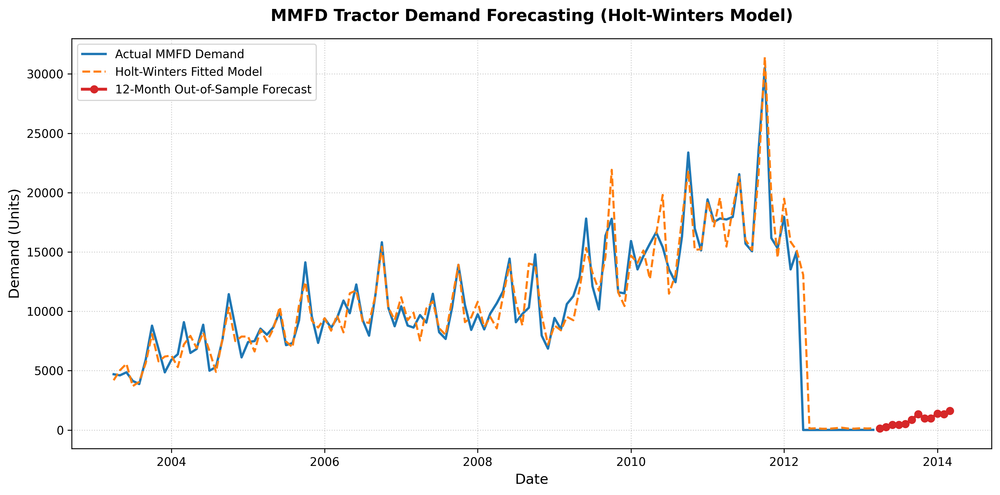

#  MMFD Tractor Demand Forecasting & Inventory Optimization

## 📌 Project Overview
Mahindra & Mahindra Farm Division (MMFD) experienced irregular tractor supply shortages due to inaccurate aggregate demand forecasting, leading to stockouts, elevated operational costs, and customer dissatisfaction[cite: 2].

This project models historical demand data (April 2003 – March 2012) and generates a **12-month out-of-sample forecast (April 2012 – March 2013)** using multi-tier statistical techniques in **Excel** and **Python**.

---

## 🛠️ Methodological Progression

### 1. Exploratory Regression Analysis (Part 1)
- Analyzed the relationship between total Farming Supply Industry demand and MMFD sales[cite: 2].
- Evaluated correlation ($R = 0.978$) and coefficient of determination ($R^2 = 0.956$)[cite: 3, 4].

### 2. Baseline Model Evaluation (Part 2)
- Implemented **Exponential Smoothing** ($\alpha = 0.3$) and Excel's automated **Forecast Sheet (ETS)**[cite: 6, 8, 9].
- Assessed fitted error metrics (MAE, RMSE, SMAPE) and identified inability to capture extreme seasonal peaks[cite: 6, 7].

### 3. Holt-Winters Multiplicative Seasonal Model (Part 3)
- Constructed a full triple exponential smoothing model tracking Level ($a$), Trend ($b$), and Seasonality ($c$).
- Utilized **Excel Solver (GRG Nonlinear)** to optimize parameters by minimizing Mean Absolute Error (MAE).
- Replicated and automated the model using **Python (`statsmodels`, `pandas`, `matplotlib`)**.

---

## 📊 Key Results

| Model Metric | Value |
| :--- | :--- |
| **Historical Data Range** | Apr 2003 – Mar 2012 (108 months)[cite: 2] |
| **Forecast Horizon** | Apr 2012 – Mar 2013 (12 months) |
| **Peak Demand Forecast (Oct 2012)** | ~26,071 Units |

---

## 📈 Visual Output


---

## 🚀 How to Run locally

### Excel Files
Open the `.xlsx` files in `/data` to review dynamic formulas, Solver configurations, and built-in charts[cite: 2, 6].

### Python Script
```bash
pip install pandas numpy statsmodels matplotlib openpyxl
python main.py
